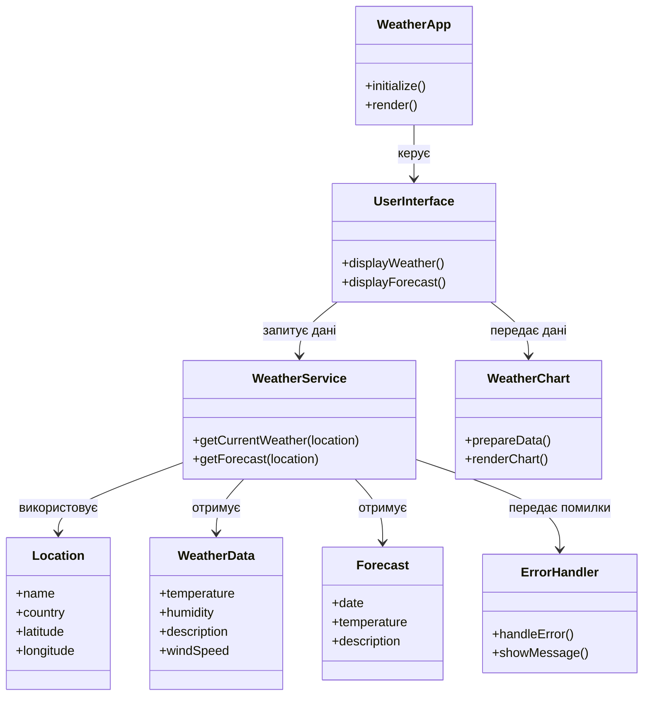

# Практичні роботи з програмної інженерії

## Команда «Свась і уци 🤙🏿»

### Учасники команди

1. **Ліщук Даниїл**
2. **Савинець Олександр**
3. **Маркусь Христина**
4. **Чудінович Максим**
5. **Шкабура Дарія**

---

# Проєкт

## Назва проєкту

**Weather Forecast — вебзастосунок для перегляду прогнозу погоди**

## Репозиторій

[GitHub — LoReXyS/laba](https://github.com/LoReXyS/laba)

## Використані технології

* **JavaScript**
* **HTML5**
* **CSS3**
* **React**
* **Vite**
* **React Compiler**
* **React TypeScript Compiler**
* **Chart.js**
* **React Chart.js 2**
* **Swiper**

---

# Практична робота №1

## Вступ до програмної інженерії та формування команди

### Мета

Ознайомитися з поняттям програмної інженерії, основними етапами створення програмного продукту та організувати роботу над навчальним проєктом.

### 1. Команда

Назва команди:

> **«Свась і уци 🤙🏿»**

Склад команди:

| № | Учасник            |
| - | ------------------ |
| 1 | Ліщук Даниїл       |
| 2 | Савинець Олександр |
| 3 | Маркусь Христина   |
| 4 | Чудінович Максим   |
| 5 | Шкабура Дарія      |

### 2. Ролі учасників

| Учасник            | Роль                                |
| ------------------ | ----------------------------------- |
| Ліщук Даниїл       | Team Lead / Frontend Developer      |
| Савинець Олександр | Frontend Developer                  |
| Маркусь Христина   | UI/UX Designer / Frontend Developer |
| Чудінович Максим   | Frontend Developer / Tester         |
| Шкабура Дарія      | Business Analyst / Documentation    |

Ролі можуть частково перетинатися, оскільки проєкт є навчальним та розробляється командою спільно.

---

## 3. Що таке програмна інженерія

**Програмна інженерія** — це галузь, яка займається систематичним проєктуванням, розробкою, тестуванням, впровадженням та супроводом програмного забезпечення.

Основна мета програмної інженерії — створити якісний, надійний, зрозумілий та зручний програмний продукт, який відповідає потребам користувачів.

---

## 4. Основні етапи створення програмного продукту

Основними етапами є:

1. Аналіз проблеми.
2. Визначення потреб користувачів.
3. Формування вимог.
4. Проєктування системи.
5. Розробка.
6. Тестування.
7. Випуск програмного продукту.
8. Супровід та подальше вдосконалення.

---

# Project Vision

## Назва продукту

**Weather Forecast**

## Проблема

Користувачам необхідно швидко отримувати актуальну інформацію про погоду, температуру та прогноз на майбутній час.

Звичайні погодні сервіси можуть містити велику кількість непотрібної інформації, тому метою нашого проєкту є створення простого та зрозумілого вебзастосунку для швидкого перегляду прогнозу погоди.

## Цільові користувачі

Цільовими користувачами є:

* студенти;
* школярі;
* працівники;
* туристи;
* водії;
* люди, які планують поїздки;
* будь-які користувачі, яким необхідно дізнатися прогноз погоди.

## Короткий опис продукту

**Weather Forecast** — це вебзастосунок для перегляду інформації про погодні умови.

Користувач може переглядати погодні показники, прогноз та графічне представлення зміни погодних параметрів.

Інтерфейс розроблений за допомогою **React**, а для побудови графіків використовується **Chart.js**. Проєкт запускається за допомогою **Vite**.

---

# Практична робота №2

## Аналіз проблеми, користувачів та предметної області

### Мета

Навчитися аналізувати проблему, для якої створюється програмний продукт, визначати потреби користувачів та особливості предметної області.

---

## 1. Формулювання проблеми

Основна проблема полягає у необхідності швидкого та зручного отримання інформації про поточну погоду та прогноз.

Користувачеві потрібно мати можливість отримати основну інформацію без складної навігації та великої кількості непотрібних дій.

---

## 2. Потреби користувачів

Користувачі потребують:

* перегляду поточної погоди;
* перегляду температури;
* перегляду прогнозу;
* отримання інформації у зрозумілому вигляді;
* графічного відображення погодних показників;
* зручного інтерфейсу;
* швидкої роботи вебзастосунку;
* коректного відображення на різних пристроях.

---

## 3. Цільова аудиторія

Основна цільова аудиторія:

**люди віком від 14 років, які користуються смартфонами, планшетами або комп'ютерами та регулярно перевіряють прогноз погоди.**

Окремими групами користувачів можуть бути:

* студенти;
* туристи;
* водії;
* мандрівники;
* працівники, які працюють на відкритому повітрі.

---

## 4. Основні об'єкти предметної області

До основних об'єктів системи належать:

### Користувач

Людина, яка використовує вебзастосунок для отримання інформації про погоду.

### Місто / локація

Місце, для якого користувач хоче отримати прогноз погоди.

### Погодні дані

Інформація про:

* температуру;
* погодні умови;
* прогноз;
* інші погодні показники.

### Прогноз

Інформація про очікувані погодні умови на певний період часу.

### Графік

Візуальне представлення зміни погодних показників.

---

## 5. Взаємозв'язки між об'єктами

Основний взаємозв'язок:

**Користувач → Локація → Погодні дані → Прогноз → Графік**

Користувач обирає або переглядає певну локацію, після чого система відображає відповідні погодні дані та прогноз.

---

## 6. Основні сценарії використання

### Сценарій 1 — Перегляд погоди

1. Користувач відкриває вебзастосунок.
2. Система завантажує погодні дані.
3. Користувач переглядає поточну інформацію.
4. Система відображає погодні показники.

### Сценарій 2 — Перегляд прогнозу

1. Користувач відкриває розділ прогнозу.
2. Система отримує інформацію.
3. Користувач переглядає прогноз.
4. Дані відображаються у зручному форматі.

### Сценарій 3 — Перегляд графіка

1. Користувач відкриває графічне представлення.
2. Система формує графік.
3. Користувач аналізує зміну погодних показників.

---

## 7. Межі системи

### До системи входить:

* вебінтерфейс;
* відображення погодної інформації;
* відображення прогнозу;
* графічне представлення даних;
* взаємодія користувача з інтерфейсом;
* адаптивне відображення.

### До системи не входить:

* професійний метеорологічний аналіз;
* керування метеорологічними станціями;
* прогнозування погоди власними математичними моделями;
* заміна професійних метеорологічних систем.

---

# Практична робота №3

## Життєвий цикл програмного забезпечення

### Мета

Ознайомитися з моделями життєвого циклу програмного забезпечення та обрати найбільш відповідну модель для власного проєкту.

---

## 1. Основні моделі життєвого циклу

### Каскадна модель

Розробка відбувається послідовно:

**Вимоги → Проєктування → Розробка → Тестування → Впровадження**

Перевагою є простота організації.

Недоліком є складність внесення змін після завершення певного етапу.

### Ітераційна модель

Продукт створюється декількома ітераціями. Після кожної ітерації система покращується.

### Agile

Agile передбачає гнучкий підхід до розробки, постійний зворотний зв'язок та можливість швидко змінювати вимоги.

---

## 2. Обрана модель

Для проєкту **Weather Forecast** обрано **Agile / ітераційний підхід**.

### Обґрунтування

Проєкт є навчальним та розробляється командою. Під час роботи можуть змінюватися вимоги до інтерфейсу та функціональності.

Agile дозволяє:

* розподілити роботу між учасниками;
* поступово створювати функціональність;
* швидко виправляти помилки;
* отримувати результат після кожної ітерації;
* додавати нові можливості.

---

## 3. Етапи життєвого циклу

```text
┌─────────────────────┐
│ Аналіз проблеми     │
└──────────┬──────────┘
           ↓
┌─────────────────────┐
│ Визначення вимог    │
└──────────┬──────────┘
           ↓
┌─────────────────────┐
│ Проєктування        │
└──────────┬──────────┘
           ↓
┌─────────────────────┐
│ Розробка React      │
└──────────┬──────────┘
           ↓
┌─────────────────────┐
│ Тестування          │
└──────────┬──────────┘
           ↓
┌─────────────────────┐
│ Демонстрація        │
└──────────┬──────────┘
           ↓
┌─────────────────────┐
│ Покращення          │
└──────────┬──────────┘
           │
           └──────────────→ Нова ітерація
```

---

# Практична робота №4

## Формування вимог до програмного забезпечення

### Мета

Перетворити ідею програмного продукту на конкретний набір функціональних та нефункціональних вимог.

---

## 1. Користувач системи

Основний користувач:

**Користувач вебзастосунку Weather Forecast.**

Окремого адміністратора для базової версії системи не передбачено.

---

# 2. User Stories

### US-01

**Як користувач, я хочу переглядати поточну погоду, щоб знати погодні умови зараз.**

### US-02

**Як користувач, я хочу переглядати температуру, щоб розуміти, наскільки тепло або холодно.**

### US-03

**Як користувач, я хочу переглядати прогноз погоди, щоб планувати свої справи.**

### US-04

**Як користувач, я хочу бачити погодні показники у вигляді графіка, щоб швидко аналізувати їх зміни.**

### US-05

**Як користувач, я хочу переглядати інформацію про певну локацію, щоб дізнатися погоду саме в потрібному місці.**

### US-06

**Як користувач, я хочу користуватися сайтом на різних пристроях, щоб переглядати прогноз зі смартфона або комп'ютера.**

### US-07

**Як користувач, я хочу отримувати зрозуміле повідомлення при помилці завантаження даних, щоб розуміти, що сталося.**

### US-08

**Як користувач, я хочу швидко отримувати погодну інформацію, щоб не витрачати час на очікування.**

---

# 3. Функціональні вимоги

| ID    | Вимога                                                     | Пріоритет |
| ----- | ---------------------------------------------------------- | --------- |
| FR-01 | Система повинна відображати поточну погоду                 | Високий   |
| FR-02 | Система повинна відображати температуру                    | Високий   |
| FR-03 | Система повинна відображати прогноз                        | Високий   |
| FR-04 | Система повинна відображати погодні дані на графіку        | Середній  |
| FR-05 | Система повинна працювати з різними локаціями              | Високий   |
| FR-06 | Система повинна відображати помилки                        | Середній  |
| FR-07 | Система повинна забезпечувати зручну навігацію             | Високий   |
| FR-08 | Система повинна коректно відображатися на різних пристроях | Високий   |

---

# 4. Нефункціональні вимоги

### Продуктивність

Вебзастосунок повинен швидко завантажувати основний інтерфейс та погодну інформацію.

### Зручність

Інтерфейс повинен бути зрозумілим для користувача без спеціальних знань.

### Адаптивність

Сайт повинен коректно працювати на:

* ПК;
* ноутбуках;
* планшетах;
* смартфонах.

### Надійність

У разі помилки завантаження даних система повинна повідомити користувача про проблему.

### Сумісність

Застосунок повинен працювати у сучасних веббраузерах.

### Масштабованість

Архітектура проєкту повинна дозволяти додавати нові погодні функції.

---

# 5. Критерії приймання

## US-01 — Перегляд поточної погоди

**Given:** користувач відкрив вебзастосунок.

**When:** погодні дані успішно завантажилися.

**Then:** користувач бачить інформацію про поточну погоду.

---

## US-02 — Перегляд температури

**Given:** погодні дані доступні.

**When:** користувач переглядає головний екран.

**Then:** температура відображається у зрозумілому форматі.

---

## US-03 — Перегляд прогнозу

**Given:** користувач відкрив застосунок.

**When:** система отримала прогноз.

**Then:** користувач може переглянути прогноз погоди.

---

## US-04 — Графік

**Given:** погодні дані доступні.

**When:** користувач відкриває графік.

**Then:** система відображає графічне представлення погодних показників.

---

# Практична робота №5

## User Stories та критерії приймання

### Мета

Навчитися формулювати функціональність програмного продукту з точки зору користувача.

---

## Backlog User Stories

| ID    | User Story                  | Пріоритет   |
| ----- | --------------------------- | ----------- |
| US-01 | Перегляд поточної погоди    | Must Have   |
| US-02 | Перегляд температури        | Must Have   |
| US-03 | Перегляд прогнозу           | Must Have   |
| US-04 | Перегляд графіка            | Should Have |
| US-05 | Перегляд погоди для локації | Must Have   |
| US-06 | Адаптивний інтерфейс        | Must Have   |
| US-07 | Повідомлення про помилки    | Should Have |
| US-08 | Швидке завантаження даних   | Must Have   |

---

## Acceptance Criteria

### US-01

* Поточна погода відображається після завантаження.
* Дані мають бути зрозумілими користувачу.
* У разі помилки користувач отримує повідомлення.

### US-02

* Температура відображається на екрані.
* Значення має бути доступним для читання.
* Одиниці вимірювання повинні бути зрозумілими.

### US-03

* Користувач може переглянути прогноз.
* Прогноз відображається у структурованому вигляді.
* Інформація не повинна перекривати елементи інтерфейсу.

### US-04

* Графік відображається без помилок.
* Дані на графіку відповідають отриманій погодній інформації.
* Користувач може зрозуміти зміну показників.

### US-05

* Користувач може переглядати дані потрібної локації.
* Дані повинні відповідати вибраній локації.

### US-06

* Сайт коректно відображається на ПК.
* Сайт коректно відображається на смартфоні.
* Елементи інтерфейсу не повинні виходити за межі екрана.
# Практична робота №7

## Проєктування структури програмного забезпечення

### Мета

Сформувати розуміння структури майбутнього програмного продукту Weather Forecast, визначити його основні компоненти, класи та зв'язки між ними.

---

## 1. Загальна структура програмного забезпечення

Weather Forecast — це вебзастосунок для перегляду поточної погоди, прогнозу та графічного представлення погодних показників.

Програмний продукт складається з таких основних компонентів:

1. **Інтерфейс користувача (UI)** — відображає погодну інформацію та забезпечує взаємодію з користувачем.
2. **Компонент отримання даних** — відповідає за отримання погодної інформації із зовнішнього джерела.
3. **Компонент обробки даних** — опрацьовує отриману інформацію та готує її до відображення.
4. **Компонент прогнозу погоди** — відповідає за представлення прогнозу на майбутній період.
5. **Компонент графіків** — відображає зміни погодних показників за допомогою графіків.
6. **Компонент обробки помилок** — забезпечує повідомлення користувача про проблеми із завантаженням даних.

---

## 2. Відповідальність компонентів

| Компонент | Відповідальність |
|---|---|
| WeatherApp | Організація роботи основного застосунку |
| UserInterface | Відображення даних та взаємодія з користувачем |
| WeatherService | Отримання погодних даних |
| WeatherData | Зберігання інформації про погодні умови |
| Forecast | Представлення прогнозу погоди |
| WeatherChart | Візуалізація погодних показників |
| ErrorHandler | Обробка помилок та повідомлення користувача |

---

## 3. Основні сутності системи

### Користувач (User)

Людина, яка використовує вебзастосунок для перегляду погоди.

### Локація (Location)

Місто або інше місце, для якого потрібно отримати погодну інформацію.

### Погодні дані (WeatherData)

Містять інформацію про температуру, погодні умови, вологість та інші доступні показники.

### Прогноз (Forecast)

Містить дані про очікувані погодні умови на певний період.

### Графік (WeatherChart)

Забезпечує графічне відображення зміни погодних показників.

---

## 4. Основні класи та їхні атрибути

### Клас WeatherApp

Відповідає за загальну організацію роботи вебзастосунку.

Основні методи:
- `initialize()` — ініціалізація застосунку;
- `render()` — відображення інтерфейсу.

### Клас WeatherService

Відповідає за отримання погодних даних.

Основні методи:
- `getCurrentWeather(location)` — отримання поточної погоди;
- `getForecast(location)` — отримання прогнозу.

### Клас Location

Атрибути:
- `name` — назва міста;
- `country` — країна;
- `latitude` — широта;
- `longitude` — довгота.

### Клас WeatherData

Атрибути:
- `temperature` — температура;
- `humidity` — вологість;
- `description` — опис погодних умов;
- `windSpeed` — швидкість вітру.

### Клас Forecast

Атрибути:
- `date` — дата прогнозу;
- `temperature` — прогнозована температура;
- `description` — очікувані погодні умови.

### Клас WeatherChart

Відповідає за відображення графіків погодних показників.

Основні методи:
- `prepareData()` — підготовка даних для графіка;
- `renderChart()` — побудова графіка.

### Клас ErrorHandler

Відповідає за обробку помилок під час отримання та обробки даних.

Основні методи:
- `handleError()` — обробка помилки;
- `showMessage()` — відображення повідомлення користувачу.

---

## 5. Class Diagram

Нижче наведено спрощену діаграму класів системи Weather Forecast.



---

## 6. Зв'язки між класами

Основні зв'язки між класами:

- `WeatherApp` організовує роботу інтерфейсу користувача.
- `UserInterface` взаємодіє з `WeatherService` для отримання погодної інформації.
- `WeatherService` використовує `Location` для визначення місця, для якого потрібен прогноз.
- `WeatherService` отримує та передає погодні дані у вигляді об'єктів `WeatherData` і `Forecast`.
- `WeatherChart` використовує погодні дані для побудови графіків.
- `ErrorHandler` обробляє помилки, які можуть виникнути під час отримання даних.

---

## 7. Обґрунтування проєктних рішень

Під час проєктування структури Weather Forecast обрано компонентний підхід, за якого кожен компонент відповідає за окрему частину функціональності.

Основні переваги такого підходу:

- **Модульність:** компоненти можна розробляти та вдосконалювати окремо.
- **Зручність супроводу:** помилки простіше знаходити та виправляти.
- **Повторне використання:** окремі компоненти можна використовувати в різних частинах застосунку.
- **Масштабованість:** у майбутньому можна додавати нові погодні показники та способи їх відображення.

Запропонована діаграма є логічною моделлю структури системи, а не точним переліком реалізованих у коді класів.

---

## Висновок

У ході практичної роботи було визначено основні компоненти вебзастосунку Weather Forecast, їхню відповідальність, основні сутності та класи. Побудовано спрощену діаграму класів і пояснено зв'язки між її елементами.

Розроблена структура допомагає зрозуміти організацію програмного забезпечення та створює основу для подальшого розвитку проєкту.

---

# Практична робота №8

## Проєктування інтерфейсу користувача

### Мета

Навчитися проєктувати зручний інтерфейс користувача для вебзастосунку Weather Forecast, визначати основні екрани, навігацію та користувацькі сценарії.

---

## 1. Загальна концепція інтерфейсу

Інтерфейс Weather Forecast має забезпечувати швидкий і зрозумілий доступ до інформації про погоду.

Основні принципи проєктування:

- простота та зрозумілість;
- логічне розташування елементів;
- зручний пошук потрібної локації;
- наочне відображення погодних показників;
- адаптивність для комп'ютерів, планшетів і смартфонів;
- зрозумілі повідомлення про завантаження та помилки.

---

## 2. Основні екрани застосунку

### Екран 1 — Головна сторінка

Призначення: відображення основної інформації про поточну погоду.

Основні елементи:
- назва та логотип Weather Forecast;
- поле пошуку міста;
- назва вибраної локації;
- поточна температура;
- опис погодних умов;
- основні погодні показники;
- перехід до детального прогнозу.

### Екран 2 — Прогноз погоди

Призначення: перегляд прогнозу на майбутній період.

Основні елементи:
- назва локації;
- список прогнозованих погодних показників;
- дати та час прогнозу;
- температура;
- описи погодних умов;
- кнопка повернення на головну сторінку.

### Екран 3 — Графіки погоди

Призначення: графічне представлення зміни погодних показників.

Основні елементи:
- графік зміни температури;
- підписи осей;
- часові позначки;
- вибір доступного погодного показника;
- навігація до інших розділів.

### Екран 4 — Стан завантаження або помилки

Призначення: інформування користувача про процес отримання даних або виникнення проблеми.

Основні елементи:
- індикатор завантаження;
- текст повідомлення;
- кнопка повторного завантаження;
- можливість повторно ввести назву міста.

---

## 3. Навігація між екранами

Основна навігація складається з трьох головних розділів:

1. Головна — поточна погода.
2. Прогноз — погодні умови на майбутній період.
3. Графіки — візуалізація зміни погодних показників.

Користувач може переходити між розділами за допомогою навігаційного меню. Пошук міста дозволяє отримувати погодну інформацію для потрібної локації.

---

## 4. Основні користувацькі сценарії

### Сценарій 1 — Перегляд поточної погоди

1. Користувач відкриває вебзастосунок.
2. Система завантажує погодні дані.
3. Користувач бачить поточну температуру та опис погоди.
4. Користувач переглядає додаткові погодні показники.

### Сценарій 2 — Пошук міста

1. Користувач вводить назву міста в поле пошуку.
2. Система перевіряє введене значення.
3. Система отримує погодні дані для вибраної локації.
4. Інтерфейс оновлюється відповідно до отриманих даних.

Якщо місто не знайдено або запит завершився помилкою, користувач отримує зрозуміле повідомлення.

### Сценарій 3 — Перегляд прогнозу

1. Користувач переходить до розділу прогнозу.
2. Система відображає доступні прогнозовані показники.
3. Користувач переглядає погоду на потрібний період.
4. За необхідності користувач повертається на головну сторінку.

### Сценарій 4 — Перегляд графіка

1. Користувач відкриває розділ графіків.
2. Система підготовлює доступні погодні дані.
3. Графік відображає зміну температури або іншого показника.
4. Користувач аналізує зміни погодних умов.

---

## 5. Прототип у Figma

Для проєктування інтерфейсу необхідно створити інтерактивний прототип у Figma.

Посилання на сервіс: https://www.figma.com/

Під час створення прототипу потрібно передбачити такі фрейми:

| № | Назва фрейму | Призначення |
|---|---|---|
| 1 | Home | Головний екран із поточною погодою |
| 2 | Forecast | Перегляд прогнозу |
| 3 | Charts | Графічне представлення погодних показників |
| 4 | Loading / Error | Стан завантаження або помилки |

Для кожного фрейму потрібно створити макет із заголовками, кнопками, картками погодних показників та навігаційними елементами.

Під час оформлення рекомендується використовувати єдину кольорову палітру, читабельний шрифт, однакові стилі кнопок і достатні відступи між елементами.

**Посилання на створений Figma-прототип:** [додати посилання після створення прототипу].

---

## 6. Переходи між екранами

В інтерактивному прототипі необхідно налаштувати такі переходи:

- `Home → Forecast` — натискання кнопки перегляду прогнозу.
- `Home → Charts` — перехід до графіків.
- `Forecast → Home` — повернення на головну сторінку.
- `Charts → Home` — повернення на головну сторінку.
- `Home → Loading / Error` — демонстрація стану завантаження або помилки.
- `Loading / Error → Home` — повернення до основного інтерфейсу після повторної спроби.

Переходи налаштовуються у вкладці Prototype в Figma за допомогою інтерактивних зв'язків між фреймами.

---

## 7. Перевірка відповідності інтерфейсу вимогам

| Вимога | Спосіб перевірки | Очікуваний результат |
|---|---|---|
| Перегляд поточної погоди | Відкрити Home | Погодні показники зрозуміло відображаються |
| Пошук локації | Ввести назву міста | Інтерфейс передбачає пошук потрібного міста |
| Перегляд прогнозу | Перейти до Forecast | Відображається структура прогнозу |
| Перегляд графіків | Перейти до Charts | Передбачено місце для графічного представлення даних |
| Обробка помилок | Відкрити Loading / Error | Користувач бачить повідомлення та спосіб повторної спроби |
| Зручна навігація | Перевірити переходи | Користувач може переходити між основними екранами |
| Адаптивність | Перевірити макети різних розмірів | Елементи не перекриваються та залишаються читабельними |

---

## 8. Обґрунтування проєктних рішень

Інтерфейс розробляється з урахуванням потреб користувачів, яким важливо швидко отримувати погодну інформацію.

Головна сторінка містить основні показники, щоб користувачеві не доводилося переходити між великою кількістю розділів. Прогноз і графіки винесено в окремі екрани для зручнішого перегляду детальної інформації.

Передбачено повідомлення про помилки, що допомагає користувачеві зрозуміти причину відсутності даних. Адаптивне компонування забезпечує можливість використання вебзастосунку на різних пристроях.

Прототип у Figma дозволяє перевірити розташування елементів і логіку переходів до початку або під час реалізації інтерфейсу в коді.

---

## Висновок

У ході практичної роботи було визначено основні екрани вебзастосунку Weather Forecast, описано навігацію та розроблено основні користувацькі сценарії. Визначено вимоги до інтерактивного прототипу у Figma та критерії перевірки зручності інтерфейсу.

Спроєктований інтерфейс має забезпечувати простий доступ до поточної погоди, прогнозу та графіків, а також зрозумілу взаємодію з користувачем у разі помилок.


# Практичні роботи №9–10
## Основи Git та GitHub. Командна робота з Git та GitHub

**Студент:** Данило  
**Спеціальність:** Інженерія програмного забезпечення  
**Навчальний заклад:** Луцький національний технічний університет

---

## Практична робота №9. Основи Git та GitHub

### Мета роботи
Ознайомитися із системами контролю версій та навчитися працювати з Git і GitHub. Отримати практичні навички створення репозиторіїв, керування версіями програмного коду та роботи з віддаленими репозиторіями.

### Хід виконання роботи

1. Встановлено Git на комп'ютер та виконано початкове налаштування користувача.
2. Створено репозиторій на платформі GitHub.
3. Створено файл `.gitignore` для виключення непотрібних файлів із репозиторію.
4. Створено файл `README.md` з описом проєкту.
5. Виконано клонування репозиторію за допомогою команди `git clone`.
6. Виконано додавання файлів до індексу за допомогою `git add`.
7. Створено коміти для збереження змін за допомогою `git commit`.
8. Відправлено зміни до віддаленого репозиторію командою `git push`.
9. Отримано актуальні зміни з віддаленого репозиторію за допомогою `git pull`.
10. Переглянуто історію змін за допомогою `git log`.
11. Створено окрему гілку командою `git branch` для роботи над новими змінами.

### Використані команди Git

```bash
git init
git clone
git add .
git commit -m "Initial commit"
git push
git pull
git log
git branch
```

### Результат роботи
У результаті практичної роботи було отримано базові навички використання Git та GitHub, створено та налаштовано репозиторій, освоєно основні команди для керування версіями програмного коду.

---

## Практична робота №10. Командна робота з Git та GitHub

### Мета роботи
Навчитися використовувати Git та GitHub для спільної розробки програмного забезпечення, організації командної роботи, перевірки коду та вирішення конфліктів під час злиття гілок.

### Хід виконання роботи

1. Створено окремі гілки для учасників командної роботи.
2. Виконано внесення змін до програмного коду у власних гілках.
3. Створено Pull Request для запропонування змін до основної гілки.
4. Проведено Code Review для перевірки якості та правильності написаного коду.
5. Опрацьовано зауваження та внесено необхідні виправлення.
6. Виконано злиття гілок (Merge) після перевірки змін.
7. Розглянуто ситуацію виникнення конфлікту під час злиття гілок.
8. Виконано вирішення простого Merge Conflict шляхом редагування конфліктного файлу та підтвердження змін.

### Використані команди Git

```bash
git branch
git checkout -b feature-branch
git add .
git commit -m "Add changes"
git push origin feature-branch
git pull origin main
git merge feature-branch
```

### Результат роботи
У результаті практичної роботи було освоєно основні принципи командної розробки з використанням Git та GitHub. Отримано навички створення гілок, роботи з Pull Request, проведення Code Review, злиття гілок та вирішення конфліктів.

---

## Посилання на репозиторій

GitHub: https://github.com/LoReXyS/laba.git

---

## Висновок

Під час виконання практичних робіт №9 та №10 було вивчено основи системи контролю версій Git та платформи GitHub. Отримано практичні навички створення репозиторіїв, керування гілками, збереження та синхронізації змін, а також організації командної роботи через Pull Request, Code Review та Merge. Виконання завдань дозволило краще зрозуміти процес спільної розробки програмного забезпечення та важливість контролю версій у роботі програміста.

